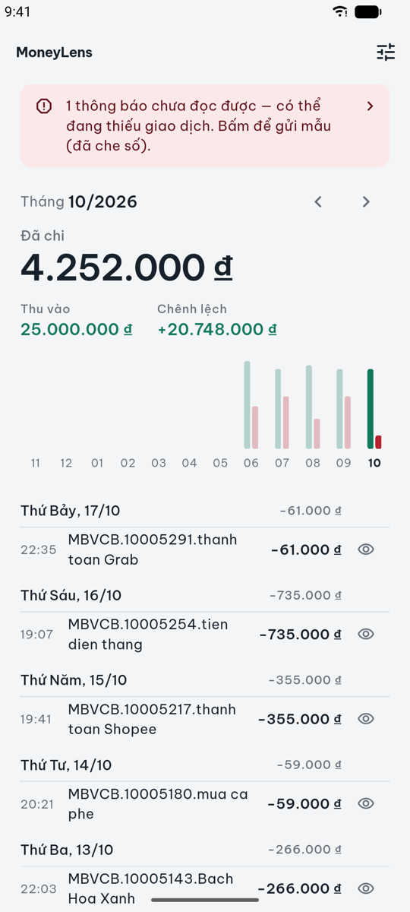
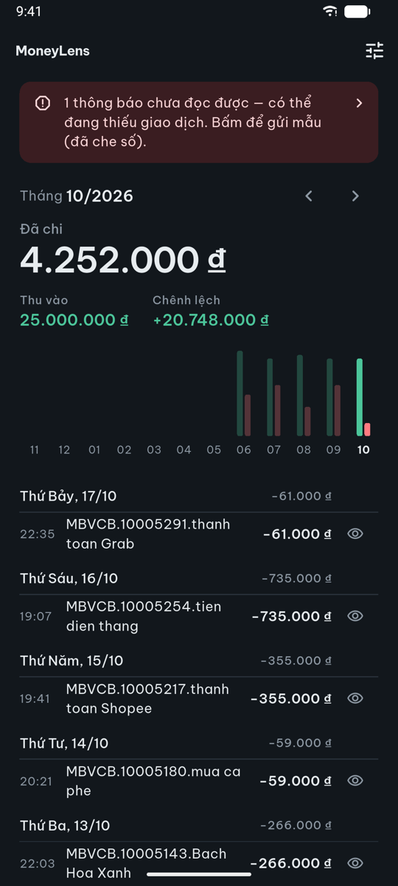
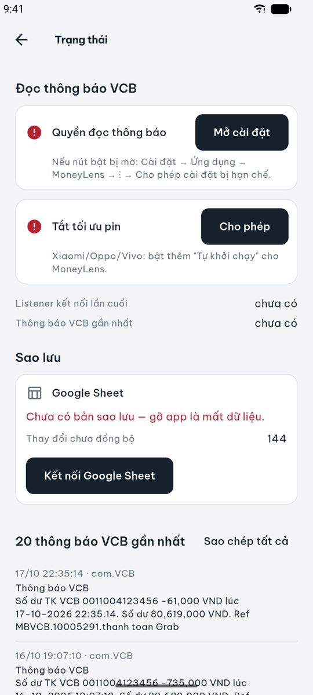
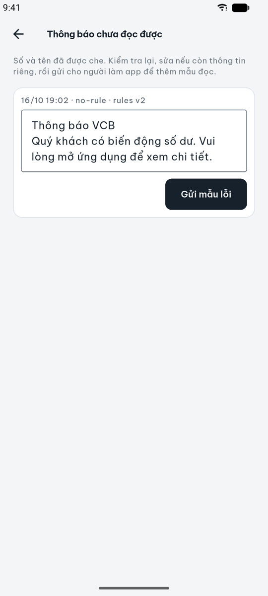
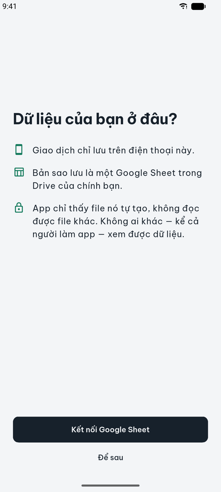

# MoneyLens

App Android cá nhân tự ghi lại giao dịch Vietcombank từ thông báo của VCB Digibank, rồi tính tổng thu, tổng chi, chênh lệch theo tháng. Viết bằng Flutter, phần bắt thông báo chạy nền viết bằng Kotlin.

**Không có backend.** Giao dịch chỉ nằm trên điện thoại (SQLite) và trong một Google Sheet ở Drive của chính người dùng. Token Google không rời khỏi máy; scope `drive.file` chỉ cho app đụng vào file do app tạo.

- Hướng dẫn cài cho người dùng: [docs/install-guide.md](docs/install-guide.md)
- Setup Google Cloud (làm một lần): [docs/setup-google-cloud.md](docs/setup-google-cloud.md)
- Thiết kế: [docs/superpowers/specs/2026-10-16-moneylens-local-first-design.md](docs/superpowers/specs/2026-10-16-moneylens-local-first-design.md)

## Ảnh màn hình

Dữ liệu trong ảnh là giao dịch giả.

| Dashboard | Dashboard (tối) | Trạng thái |
| :---: | :---: | :---: |
|  |  |  |
| **Thông báo chưa đọc được** | **Lần đầu mở app** | |
|  |  | |

## Tính năng

- Bắt thông báo biến động số dư VCB kể cả khi app không mở (`NotificationListenerService`).
- Parse trên máy bằng luật regex trong file JSON; sửa luật không cần phát APK mới.
- Dashboard: tổng thu, tổng chi theo tháng, biểu đồ nhiều tháng, danh sách giao dịch, ẩn giao dịch khỏi thống kê.
- Đồng bộ một chiều app → Google Sheet: khi mở app, chạy nền khoảng 6 giờ một lần, hoặc bấm "Đồng bộ ngay".
- Khôi phục từ Sheet sang máy mới (chỉ khi sổ trên máy còn trống).
- Màn thông báo chưa parse được: hiện lý do lỗi, ký tự ẩn, cho người dùng tự gửi mẫu đã che số tiền, số tài khoản và tên.

## Kiến trúc

```text
VcbNotificationListener (Kotlin)
  lọc package VCB → INSERT nguyên văn vào capture.db (append-only)
        │
        v  Dart mở read-only
Ingest (Dart): parse bằng parser-rules.json → moneylens.db
        │
        ├── UI: dashboard, trạng thái, thông báo lỗi
        └── Sync: ghi đè tab "Giao dịch" trong Google Sheet của người dùng
```

- **Hai file SQLite, mỗi file một chủ.** Kotlin sở hữu `capture.db` (chỉ bảng `raw_events`); Dart sở hữu `moneylens.db`. Listener ghi được khi không có Flutter engine, và không có hai nơi cùng migrate một schema.
- **Giữ nguyên văn thông báo.** Khi luật đổi, các thông báo lỗi được parse lại.
- **Sync ghi đè toàn bộ tab** thay vì append, nên chạy lại không sinh dòng trùng.
- **Luật parser** đóng gói sẵn trong app; app tải bản mới từ GitHub raw và dùng bản có `version` cao hơn. Request chỉ là GET, không gửi dữ liệu.

## Cấu trúc thư mục

```text
app/
  android/app/src/main/kotlin/…   listener + capture.db
  assets/parser-rules.json        luật parse (app cũng tải bản mới nhất trên main)
  lib/
    capture/     đọc raw_events từ capture.db
    ingest/      parse raw → giao dịch
    parser/      luật regex, tải luật từ GitHub
    data/        moneylens.db, ledger, giờ Việt Nam
    sync/        Google Sheets, đồng bộ tự động và nền (WorkManager)
    auth/        Google Sign-In
    dashboard/   màn chính, biểu đồ tháng
    onboarding/  kết nối Sheet, khôi phục
    report/      thông báo chưa parse được, che dữ liệu nhạy cảm
    status/      màn trạng thái, quyền
  scripts/build-apk.sh
docs/            hướng dẫn cài, setup Google Cloud, spec và plan
```

## Phát triển

Yêu cầu: Flutter (Dart SDK `^3.13.5`), Android SDK, một thiết bị hoặc emulator Android. App chỉ hỗ trợ Android.

```bash
cd app
flutter pub get
flutter test
```

Đăng nhập Google cần Web Client ID truyền lúc build (xem [setup-google-cloud.md, mục 4](docs/setup-google-cloud.md#4-đưa-client-id-web-vào-build)). Lưu một lần vào `app/dart_defines.json` (đã gitignore):

```bash
echo '{"GOOGLE_SERVER_CLIENT_ID": "<web-client-id>.apps.googleusercontent.com"}' > app/dart_defines.json
cd app && flutter run --dart-define-from-file=dart_defines.json
```

Thiếu Client ID thì app vẫn chạy, chỉ phần Google Sheet báo lỗi `clientConfigurationError`.

## Build APK

```bash
app/scripts/build-apk.sh
```

APK ra ở `app/build/app/outputs/flutter-apk/moneylens-<version>.apk`, với `<version>` lấy từ dòng `version:` trong `app/pubspec.yaml`. Tăng version trước mỗi lần phát bản mới.

APK release phải ký bằng **một keystore cố định**: OAuth client Android gắn với SHA-1 của chứng chỉ ký, đổi keystore là đăng nhập Google hỏng. Keystore và `key.properties` không commit vào repo.

## Sửa luật parser khi VCB đổi mẫu tin

1. Sửa `app/assets/parser-rules.json`, **tăng `version`**.
2. Thêm mẫu (đã che dữ liệu thật) vào `app/test/parser/fixtures/synthetic_vcb.json` và chạy `flutter test test/parser`.
3. Push lên `main`. App tải luật mới ở lần mở app hoặc lần sync nền tiếp theo, rồi parse lại các thông báo lỗi.

## Icon

File SVG gốc nằm trong `app/assets/icon/`. Sau khi xuất lại PNG:

```bash
cd app && dart run flutter_launcher_icons
```
